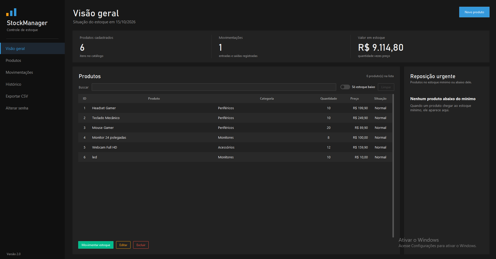

# 📦 Sistema de Gestão de Estoque

Sistema desktop desenvolvido em Python com interface gráfica
Tkinter e integração com banco de dados MySQL.

## 🚀 Tecnologias utilizadas

- Python
- Tkinter
- MySQL
- MySQL Connector
- XAMPP
- MySQL Workbench

## 📋 Sobre o projeto

Este projeto consiste em uma aplicação desktop voltada
ao gerenciamento de estoque.

Foi desenvolvido com o objetivo de aprimorar meus
conhecimentos em programação Python, desenvolvimento
de interfaces gráficas e integração com bancos de dados.

## 🖥️ Demonstração do sistema

### 📸 Tela Principal

## ⚙️ Como executar

### 1. Clone o repositório

git clone https://github.com/VitorHFTeixeira/gestao-estoque-python.git

### 2. Instale a dependência

pip install mysql-connector-python

### 3. Configure o MySQL

Configure o banco de dados MySQL e a conexão
utilizada no arquivo database.py.

### 4. Execute o sistema

python main.py

## 🔒 Segurança

O arquivo senha.json não está disponível no repositório
por conter informações de autenticação.

## 👨‍💻 Desenvolvedor

Vitor Teixeira

GitHub: https://github.com/VitorHFTeixeira
